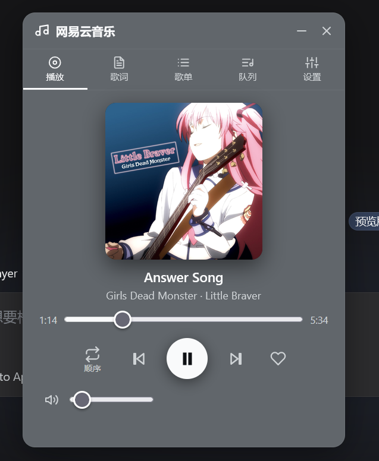
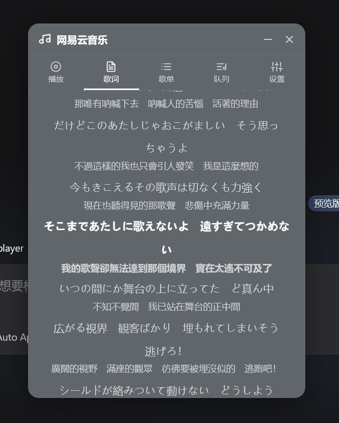
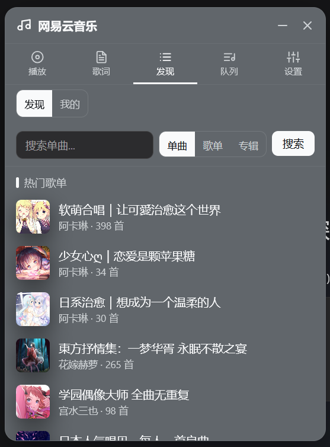
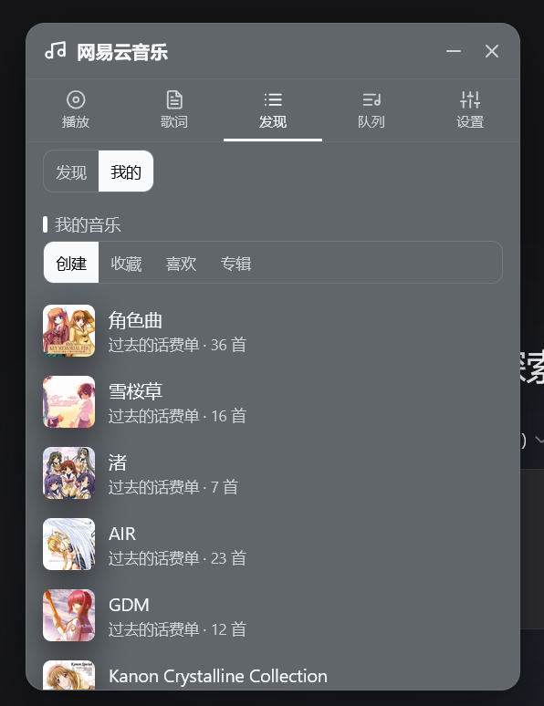
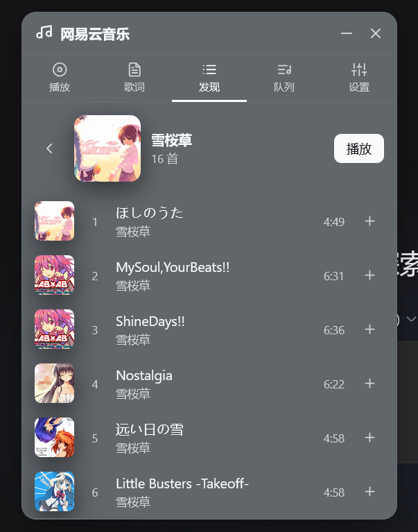
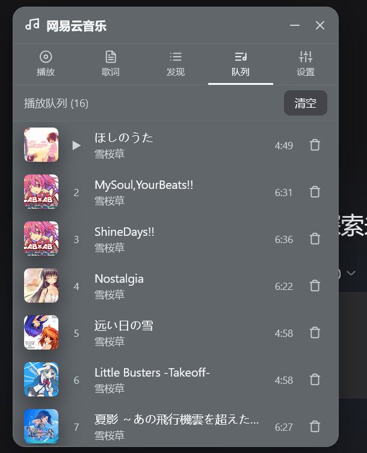
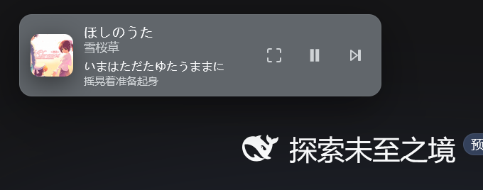

# ncm-player3 — 网易云音乐浮窗（点击外部自动收起 + 无操作自动退出 + 播放心跳提示）

[ncm-player](https://github.com/WolfGenerals/ncm-player) 1.2.0 的衍生版本：行为与原插件完全一致，额外新增三个功能——

1. **用鼠标点击播放窗口以外的任意区域，播放窗口会自动收起成迷你条**（继承自 ncm-player2，等同于点击窗口右上角的 `-` 收起按钮）
2. **播放界面最小化（收起为迷你条）后，3 秒内没有任何鼠标点击或移动，自动触发 `×` 退出按钮**，界面隐藏为右下角音符按钮，播放不中断
3. **退出为音符按钮后若仍在播放，右下角图标做心跳动效**（按钮自身缩放 + 两圈扩散光环），提示"音乐播放中"；暂停时静止

一个运行在 DeepSeek Harness (DSH) Web 界面里的网易云音乐浮窗播放器：可拖拽、可折叠、可隐藏，支持单曲/歌单/专辑浏览与搜索、逐行同步歌词与翻译、播放队列、扫码/Cookie 登录，界面颜色自动跟随 DSH 皮肤主题。

## 预览

| 播放 | 歌词 |
|---|---|
|  |  |

| 发现 · 热门 | 发现 · 我的 |
|---|---|
|  |  |

| 专辑浏览 | 播放队列 | 迷你模式 |
|---|---|---|
|  |  |  |
## 功能特性

- 🎵 **播放**：播放/暂停、上一首/下一首、进度拖拽、音量与静音；支持顺序、单曲循环、随机三种模式（图标 + 文字标识，单曲循环带 "1" 角标）
- 📃 **发现**：搜索单曲 / 歌单 / 专辑（三种分类），热门歌单推荐；登录后进入「我的」，查看创建、收藏、喜欢的歌单与收藏的专辑
- 📝 **歌词**：逐行同步高亮、点击歌词跳转进度、歌词翻译（有翻译时显示）；迷你模式同样显示当前歌词，超长歌词自动横向滚动，字号可调
- 🔄 **队列**：添加、移除、清空管理；自动持久化——重启后恢复队列、进度、播放模式、音量
- 👤 **账号**：网易云 App 扫码登录，或粘贴 Cookie；登录后可查看「我的音乐」并使用收藏功能
- 🪟 **浮窗**：展开 / 迷你条 / 隐藏三种形态，均可拖拽；隐藏后为右下角音符按钮，页面打开时默认隐藏于此；颜色跟随 DSH 皮肤主题
- 🖱️ **点击窗口外即收起**（继承 ncm-player2）：完整窗口展开时，鼠标点击窗口以外的任意区域即自动折叠为迷你条，与 `-` 收起按钮等价；拖拽窗口的过程中不会触发
- ⏱️ **无操作自动退出**（ncm-player3 新增）：界面收起为迷你条后，若 3 秒内没有任何鼠标点击 / 移动（键盘、滚轮、触摸同样算"有操作"），自动触发 `×` 退出按钮，界面隐藏为右下角音符按钮，播放不中断；可在「设置」中关闭
- 💓 **播放心跳提示**（ncm-player3 新增）：退出为音符按钮后若仍在播放，右下角按钮持续心跳缩放并带扩散光环，提示音乐播放中；暂停时静止
- ⚙️ **设置**：音质（标准 128k / 高品质 320k）、歌词翻译开关、迷你歌词开关 / 滚动 / 字号、无操作自动退出开关；所有设置自动持久化

## 安装

本插件由 `@wolfgenerals/ncm-player2` 派生，包名为 `@wolfgenerals/ncm-player3`，
cordis 加载 id 为 `ncm-player3`。二者**不能同时启用**：host 半部都注册
`/ncm/api` 前缀路由，同时启用会互相抢占；因此安装本插件时应停用 ncm-player2
（在 `$DSH_HOME/profiles/<profile>/cordis.patch.yml` 中为 `ncm-player2` 加
`disabled: true`），并重启 DSH。

本地 / 手动安装示例（link 方式，与 profile 内其他本地插件一致）：

1. 把本目录放到插件目录，如 `$DSH_HOME/plugins/ncm-player3`
2. 在 `$DSH_HOME/profiles/<profile>/package.json` 中：

   ```json
   "dependencies": { "@wolfgenerals/ncm-player3": "link:../../plugins/ncm-player3" }
   ```

   并把 `@wolfgenerals/ncm-player3` 追加进 `dsh.profile.bundles`
3. 在 `$DSH_HOME/profiles/<profile>/cordis.patch.yml` 中追加：

   ```yaml
   - insert:
       - id: ncm-player3
         name: '@wolfgenerals/ncm-player3'
   - id: ncm-player2
     disabled: true
   ```
4. 重启 DSH Web 后生效

原始 npm / GitHub 安装方式（针对上游 `ncm-player`）：

```bash
dsh plugin --profile web add @wolfgenerals/ncm-player
# 或
dsh plugin --profile web add github:WolfGenerals/ncm-player
```

以上命令会将其加入 `dsh.profile.bundles` 列表（见 `$DSH_HOME/profiles/web/package.json`）。重启 DSH Web 后生效。

### 本地开发

```bash
git clone https://github.com/WolfGenerals/ncm-player.git
```

## 快速上手

1. 安装插件并重启 DSH Web 后，页面右下角出现音符按钮，点击展开播放器
2. 「发现」页搜索或选择热门歌单，点任意一首歌开始播放
3. 「播放」页可切歌、拖进度、调音量、切换播放模式；「歌词」页查看逐行歌词与翻译
4. 在「设置」页扫码登录（网易云 App 扫一扫）或粘贴 Cookie，解锁「我的音乐」与收藏
5. 点击窗口右上角 `-` 收起为迷你条，`×` 隐藏；再次打开点击右下角音符按钮
6. 收起为迷你条后停止操作 3 秒，界面自动隐藏为右下角按钮；播放中该按钮会心跳提示

## 数据保存（浏览器 localStorage）

登录态与播放队列保存在**本机浏览器 localStorage**（key：`ncmply2-settings`——与 ncm-player2 共用同一份数据，从 v2 升级时登录态与队列自动沿用；与更早的 ncm-player 的 `ncmply-settings` 相互隔离），不写入磁盘文件。ncm-player3 新增字段 `state.autoExit`（无操作自动退出开关，默认 `true`）：

```json
{
  "account": { "cookie": "...", "uid": 123, "nickname": "..." },
  "state": {
    "queue": [ { "id": 1, "name": "...", "artists": "...", "album": "...", "cover": "...", "duration": 0 } ],
    "index": -1, "mode": "order", "vol": 0.8, "quality": 320000, "time": 0,
    "showTrans": true, "showMiniLrc": true, "miniLrcScroll": true, "miniLrcSize": 11,
    "autoExit": true
  }
}
```

- 换浏览器或清除站点数据会丢失登录态 / 队列（需重新登录）
- 升级自 ≤1.0.7 的用户：旧文件 `~/.dsh/ncmply-settings` 会在启动时被**只读**读取一次并自动迁入 localStorage，随后不再写入（文件保留但不更新）
- 升级自 ncm-player2 的用户：沿用同一 key `ncmply2-settings`，登录态/队列/设置自动沿用，无需重新登录
- 浏览器隐私模式下 localStorage 不可用时，功能照常、仅不持久化
- 自动退出只在"界面已收起为迷你条"的状态下计时；窗口展开时点击外部仍先折叠为迷你条

## 注意事项

- 依赖本机 PATH 上的 Node.js 运行时，以及可访问 `music.163.com` 的网络
- 登录 Cookie 只用于请求 music.163.com，不发送给任何第三方
- 收藏（点 ❤）受网易云账号风控影响，失败时会有提示，属正常现象
- 部分歌曲受版权 / 会员限制无法播放；歌词翻译仅当歌曲有翻译数据时显示
- 仅供个人学习使用，请遵守网易云音乐服务条款与当地法律法规

## 更新记录

- **1.3.1（无声修复）**：修复"歌曲在播放但完全没有声音"的问题。原因有两处：
  1. 播放中把窗口收起（迷你条无操作自动退出为音符按钮，或点"隐藏"）时，代码为节奏跳动把
     `<audio>` 接进 Web Audio（`createMediaElementSource`），但只连到分析器、没接
     `AudioContext.destination`，于是声音被改道进图后再无出口——整首静音，且无法还原
     （`createMediaElementSource` 不可逆），必须刷新页面才恢复。现在分析器之后必定接到 destination。
  2. `<audio>` 没有设置 `crossOrigin`，网易云 CDN 属跨域音频，接进 Web Audio 后浏览器会把输出
     整体置零（跨域污染）。现在加载前统一设置 `crossOrigin="anonymous"`；无 CORS 响应头的兜底
     地址会放弃 CORS 重载一次（保证能听到），此时不接分析器、节拍退回固定心跳。
  另外接线前会校验 `AudioContext` 处于 running、元素已走 CORS 且已拿到数据（`readyState >= 2`），
  条件不满足就不接线（避免把声音接进一条没有出口或会被静音的链路），每 500ms 自检并自动补接线 /
  唤醒被挂起的上下文。万一元素"已被接管后"仍然加载失败（接管不可逆、该链路救不回来），会自动换一个
  全新的 `<audio>` 元素重播，绝不把用户留在静音状态。

## License

MIT

## 致谢

实现借鉴了 [sanwuhundun/dsh-netease-music](https://github.com/sanwuhundun/dsh-netease-music)
的网易云音乐 API 对接与登录方案。
